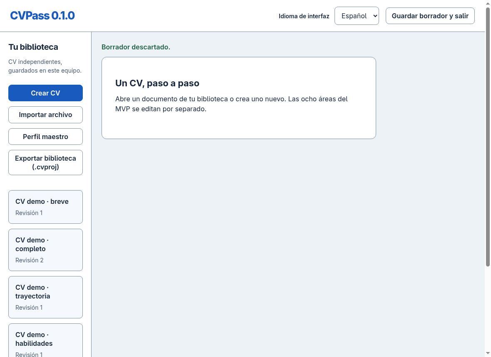

[English](README.md) | [Español](README_ES.md)

# CVPass

CVPass is a private, offline CV editor for Linux, inspired by Europass workflows.

## What is CVPass?

CVPass 0.1.0 is a local desktop application for creating and managing CVs. It is intended for Linux x86_64. Your library is saved locally; exporting is for sharing or making portable copies.

## Features

Eight areas: personal information, education, work experience, skills/groups, languages with five independent CEFR dimensions, certifications, projects and multiple custom sections. Includes photos, limited rich text, manual ordering, visibility, drafts, recovery and revisions.

## Privacy & Offline

The supported workflow runs offline, without an account, telemetry, cloud upload or CDN. Imported files are processed locally. A PDF represents only its visible export; hidden entries, history, drafts, master profile and unselected translations are excluded. A private `.cvproj` backup intentionally contains more information: keep it secure.

## Screenshots

Only synthetic demo data is used. See [screenshots and their provenance](docs/screenshots/README.md). The approved CVPass icon master is still awaited; see [branding](assets/branding/README.md).




[Master profile](docs/screenshots/profile.png) · [Editor](docs/screenshots/editor.png) · [Simple](docs/screenshots/simple.png) · [Lateral](docs/screenshots/lateral.png) · [PDF preview](docs/screenshots/preview.png)

## Installation

The primary distribution is AppImage for **Linux x86_64**, on compatible desktop Linux systems. Universal distribution compatibility is not promised. This is local release preparation: no public release/download has been published yet.

## AppImage

After obtaining the prepared AppImage and `SHA256SUMS`, place them together and run:

```sh
sha256sum -c SHA256SUMS
chmod +x CVPass-0.1.0-x86_64.AppImage
./CVPass-0.1.0-x86_64.AppImage
```

You do not need Node, npm, VS Code or a development server to run it. FUSE must work for normal mounting. If mounting is unavailable, the runtime supports:

```sh
APPIMAGE_EXTRACT_AND_RUN=1 ./CVPass-0.1.0-x86_64.AppImage
```

Do not disable the Chromium sandbox as a workaround. The local build is in `out/f9/`.

## Getting Started

Open the library, choose **Create CV**, enter a library name and display name, then open a section. **Confirm** validates and saves locally; **Cancel** discards the form. You do not need to export after every edit. After an unexpected close, recover or discard the separate draft.

## Master Profile

Use **Master profile** for reusable information in all eight areas. **Create CV from profile** lets you select personal fields, sections and entries. It creates an independent copy; later changes to the profile or another CV do not propagate automatically.

## CV Editor

Edit entries independently. Hide keeps content in the project but excludes it from the PDF. Collapse only changes the editor view. Move up/down supports keyboard ordering. Deletion is explicit; recover previous relevant states through revisions.

## Templates

**Simple** is one column; **Lateral** uses two columns. Both are original designs. Presentation settings include density, accent, date precision, numbering and CEFR guide. Changing presentation does not change content. The PDF.js preview shows the exact bytes exported for that generation.

## Importing

Choose **Import file**, inspect the review, correct supported fields and confirm. Cancel creates nothing. Supports own projects/PDF payloads and the tested structured Europass PDF/XML subset. Ambiguous or unsupported fields are reported; generic or scanned PDFs are not reconstructed.

## Exporting

**Export PDF** asks for a destination and saves the previewed bytes. A compatible own PDF can be reimported to recover that visible version, not the private source project. Export failure is reported; saving a PDF is separate from confirming edits.

## Portable Projects

**Export project (.cvproj)** preserves the full selected CV project and its declared resources/history, including hidden information. It is the reliable editable backup/transfer format. Resolve pending forms/drafts before exporting.

## Workspace Backup

**Export library (.cvproj)** creates a workspace backup with the profile, CVs, assets, settings and declared history. Import into an empty library to restore. Replacing an existing library requires explicit confirmation and a prior backup. A canceled destination or failed write is not announced as success.

## Languages

Interface Spanish/English and document Spanish/English are independent. Document language changes use a reviewable **manual/local** plan with a prior checkpoint. Official names/identifiers are protected; sensitive titles can show original, reviewed translation or both. There is no production automatic translation provider.

## Compatibility

CVForge 0.1.0 libraries, compatible `.cvproj` CV/workspace backups and own PDF payloads remain readable. Storage stays at `~/.config/CVForge/library` or `$XDG_CONFIG_HOME/CVForge/library` intentionally, so updating does not hide your library. Internal format/creator identifiers and frozen PDF technical metadata may still say CVForge; these are compatibility identities, not a second product. See [retained identifiers](docs/release/REBRANDING.md).

## Current Limitations

Linux x86_64 only; Simple/Lateral only. No OCR, generic PDF reconstruction, universal Europass import, production automatic translation, cloud, accounts, sync or auto-update. PDF/UA and complete accessibility are not certified. Large histories have additional read/copy cost (50-revision diagnostic: Confirm p95 316.6 ms, outside the official acceptance corpus). See [compatibility and limitations](docs/release/PREPARATION.md).

## Build from Source

Validated with Node.js 26 and npm on Linux; native tooling may be needed for SQLite. From the matching source/lockfile:

```sh
npm ci
npm run setup:electron
npm run build
npm start
```

Build the local binary:

```sh
npm run package:appimage
```

This builds locally and does not publish. Keep the provided third-party notices with redistribution.

## Testing

```sh
npm test
npm run typecheck
npm run build
npm run test:f9:ui
```

UI tests require an appropriate Linux graphical environment and prepared package. Additional phase/offline procedures are in [release preparation](docs/release/PREPARATION.md). Tests use synthetic data; never submit your real CV as a fixture.

## Contributing

See [CONTRIBUTING.md](CONTRIBUTING.md). Report security concerns according to [SECURITY.md](SECURITY.md), without private CVs/databases or sensitive public attachments.

## License

GNU General Public License v3.0, **GPL-3.0-only**. See [LICENSE](LICENSE) and [third-party notices](THIRD_PARTY_NOTICES.md).

## Author

**Alexandru David Raboaca Neagu**

Copyright © 2026 Alexandru David Raboaca Neagu

## Europass Disclaimer

CVPass is an independent open-source project inspired by some Europass workflows. It is not affiliated with, endorsed by, or sponsored by Europass, the European Commission, or the European Union.
