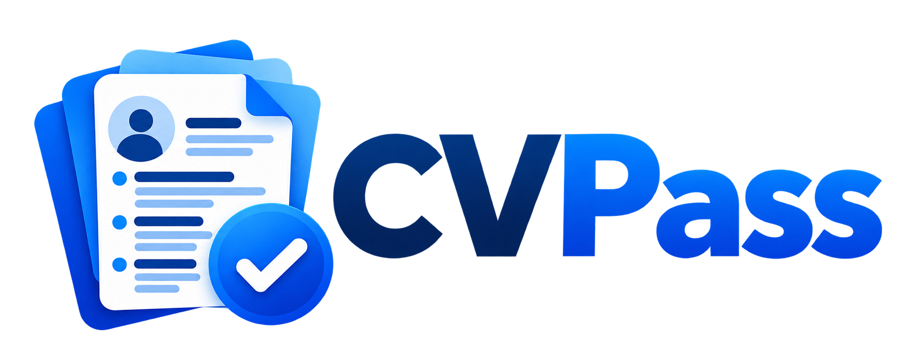

[English](README.md) | [Español](README_ES.md)

# CVPass



Un editor de CV privado y offline para Linux, inspirado en los flujos de trabajo de Europass.

## ¿Qué es CVPass?

CVPass 0.1.0 es una aplicación de escritorio local para crear y gestionar CV en Linux x86_64. La biblioteca se guarda localmente; exportar sirve para compartir o crear copias portables.

## Características

Ocho áreas: datos personales, educación, experiencia, habilidades/grupos, idiomas con cinco dimensiones CEFR independientes, certificaciones, proyectos y varias secciones personalizadas. Incluye foto, texto enriquecido limitado, orden manual, visibilidad, borradores, recuperación y revisiones.

## Privacidad y funcionamiento offline

El flujo soportado funciona sin red, cuentas, telemetría, cloud ni CDN. Los archivos importados se procesan localmente. Un PDF representa únicamente su exportación visible: excluye ocultos, historial, borradores, perfil y traducciones no elegidas. Una copia privada `.cvproj` contiene intencionadamente más información: protégela.

## Capturas

Solo se utilizan datos demo sintéticos. Consulta [capturas y procedencia](docs/screenshots/README.md). Se incluyen los assets definitivos de CVPass; consulta [branding](assets/branding/README.md).


[Perfil maestro](docs/screenshots/profile.png) · [Editor](docs/screenshots/editor.png) · [Simple](docs/screenshots/simple.png) · [Lateral](docs/screenshots/lateral.png) · [Preview PDF](docs/screenshots/preview.png)

El soporte Windows 10/11 x64 para **0.2.0 está en desarrollo**; todavía no está soportado oficialmente ni publicado. Candidatas NSIS/portable y aceptación manual: [port Windows](docs/windows/PORTING.md).

## Instalación

La distribución principal es AppImage para **Linux x86_64**, en escritorios Linux compatibles. No se promete compatibilidad universal con todas las distribuciones. Descarga la AppImage y sus checksums desde la [release CVPass 0.1.0](https://github.com/alexandruraboaca00/cvpass/releases/tag/v0.1.0).

## AppImage

Descarga [CVPass-0.1.0-x86_64.AppImage](https://github.com/alexandruraboaca00/cvpass/releases/download/v0.1.0/CVPass-0.1.0-x86_64.AppImage) y [SHA256SUMS](https://github.com/alexandruraboaca00/cvpass/releases/download/v0.1.0/SHA256SUMS), colócalos juntos y ejecuta:

```sh
sha256sum -c SHA256SUMS
chmod +x CVPass-0.1.0-x86_64.AppImage
./CVPass-0.1.0-x86_64.AppImage
```

No necesitas Node, npm, VS Code ni servidor de desarrollo para usarla. FUSE debe funcionar para montarla normalmente. Si el montaje no está disponible, el runtime permite:

```sh
APPIMAGE_EXTRACT_AND_RUN=1 ./CVPass-0.1.0-x86_64.AppImage
```

No desactives el sandbox de Chromium como solución. El build local se genera en `out/f9/`.

## Primeros pasos

Abre la biblioteca, pulsa **Crear CV**, introduce un nombre de biblioteca y de presentación y abre una sección. **Confirmar** valida y guarda localmente; **Cancelar** descarta el formulario. No necesitas exportar tras cada edición. Después de un cierre inesperado puedes recuperar o descartar el borrador separado.

## Perfil maestro

Usa **Perfil maestro** para información reutilizable en las ocho áreas. **Crear CV desde perfil** permite elegir campos personales, secciones y entradas. Crea una copia independiente: modificar después el perfil u otro CV no propaga cambios automáticamente.

## Editor de CV

Edita cada entrada por separado. Ocultar conserva su contenido en el proyecto y lo excluye del PDF. Contraer solo cambia la vista. Subir/Bajar permite ordenar con teclado. Eliminar es explícito; las revisiones permiten recuperar estados anteriores relevantes.

## Plantillas

**Simple** tiene una columna; **Lateral**, dos. Ambas son diseños originales. Presentación permite densidad, acento, precisión de fechas, numeración y guía CEFR. No cambia el contenido. La preview PDF.js muestra exactamente los bytes exportados para esa generación.

## Importación

Pulsa **Importar archivo**, revisa la propuesta, corrige campos soportados y confirma. Cancelar no crea nada. Admite proyectos/payloads propios y el subconjunto estructurado Europass PDF/XML probado. Informa de ambigüedades y campos no soportados; no reconstruye PDF genéricos o escaneados.

## Exportación

**Exportar PDF** pide destino y guarda los bytes de la preview. Un PDF propio compatible puede reimportarse para recuperar esa versión visible, no el proyecto privado original. Los fallos se informan; exportar es distinto de confirmar una edición.

## Proyectos portables

**Exportar proyecto (.cvproj)** conserva el proyecto completo del CV elegido y sus recursos/historial declarados, incluidos ocultos. Es el formato fiable para backup editable y transferencia. Resuelve formularios/borradores pendientes antes de exportar.

## Copia de la biblioteca

**Exportar biblioteca (.cvproj)** crea un backup workspace con perfil, CV, assets, ajustes e historial declarado. Importa en una biblioteca vacía para restaurar. Sustituir una existente exige confirmación y copia previa. Cancelar el destino o fallar una escritura no anuncia éxito.

## Idiomas

Interfaz español/inglés e idioma del CV español/inglés son independientes. El cambio del documento usa un plan **manual/local** revisable con checkpoint previo. Protege nombres e identificadores; los títulos sensibles permiten original, traducción revisada o ambos. No hay proveedor automático de traducción de producción.

## Compatibilidad

Las bibliotecas CVForge 0.1.0, `.cvproj` CV/workspace y payloads PDF propios compatibles siguen siendo legibles. Se conserva intencionadamente `~/.config/CVForge/library` o `$XDG_CONFIG_HOME/CVForge/library`, para no ocultar la biblioteca al actualizar. Los identificadores de formatos/creador y metadatos técnicos PDF congelados pueden seguir diciendo CVForge: son identidades de compatibilidad. Consulta [identificadores conservados](docs/release/REBRANDING.md).

## Limitaciones actuales

Solo Linux x86_64 y Simple/Lateral. Sin OCR, reconstrucción PDF genérica, importación Europass universal, traducción automática de producción, cloud, cuentas, sync ni auto-update. PDF/UA y accesibilidad completa no certificados. Un historial grande añade coste de lectura/copia (diagnóstico con 50 revisiones: Confirmar p95 316,6 ms, fuera del corpus oficial). Véanse [compatibilidad y límites](docs/release/PREPARATION.md).

## Compilar desde el código

Validado con Node.js 26 y npm en Linux; SQLite puede necesitar herramientas nativas. Usa el código y lockfile correspondientes:

```sh
npm ci
npm run setup:electron
npm run build
npm start
```

Genera el binario local:

```sh
npm run package:appimage
```

No publica nada. Conserva los avisos de terceros al redistribuir.

## Pruebas

```sh
npm test
npm run typecheck
npm run build
npm run test:f9:ui
```

Las pruebas UI necesitan un entorno gráfico Linux adecuado y el paquete preparado. Los procedimientos por fase/offline están en [preparación de release](docs/release/PREPARATION.md). Usa fixtures sintéticos; nunca subas tu CV real como fixture.

## Contribuir

Consulta [CONTRIBUTING.md](CONTRIBUTING.md). Sigue [SECURITY.md](SECURITY.md) para seguridad, sin publicar CV/bases privadas ni adjuntos sensibles.

## Licencia

GNU General Public License v3.0, **GPL-3.0-only**. Consulta [LICENSE](LICENSE) y [avisos de terceros](THIRD_PARTY_NOTICES.md).

## Autor

**Alexandru David Raboaca Neagu**

Copyright © 2026 Alexandru David Raboaca Neagu

## Aviso sobre Europass

CVPass es un proyecto independiente de código abierto inspirado en algunos flujos de trabajo de Europass. No está afiliado, respaldado ni patrocinado por Europass, la Comisión Europea ni la Unión Europea.
