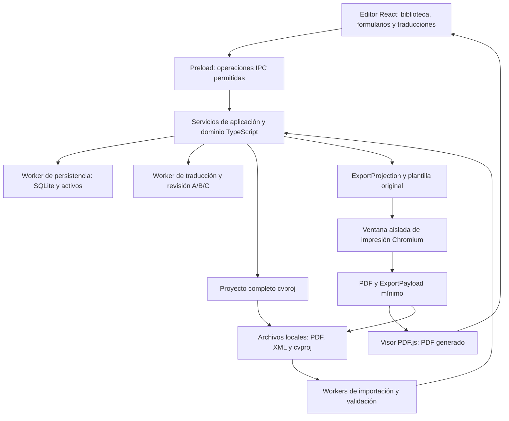

# Arquitectura propuesta

Versión 0.3 · 16 de octubre de 2026 · Stack validado en el alcance técnico F1; producto aún no implementado. Véase [registro F1](F1_VALIDATION.md).

## Decisión principal [D]

Se propone una **aplicación de escritorio local con Electron, React y TypeScript**, almacenamiento SQLite y generación de PDF mediante el Chromium incluido en Electron. El mismo PDF se muestra en la vista previa y se entrega al exportar. Biblioteca automática y `.cvproj` completo aseguran continuidad; el PDF solo representa su exportación. El ciclo principal, incluida la traducción ES/EN con recursos instalados, debe poder funcionar localmente. La traducción queda fuera del cierre F1 por decisión final del usuario; su validación de producto sigue pendiente.

La elección favorece tres prioridades del usuario: archivos locales durables, reapertura de CV y control de la composición del PDF. El coste es distribuir un runtime más pesado y mantenerlo actualizado. Linux es la plataforma inicial propuesta, no un requisito de usuario ya confirmado.

Las marcas [H], [D] y [P] tienen el significado de [REQUIREMENTS.md](REQUIREMENTS.md). **Toda la arquitectura es [D]**: la investigación no identificó el stack interno de Europass. Las decisiones finales del usuario sobre perfil, guardado, PDF, idiomas, importación y MVP prevalecen sobre la versión 0.1. Las capacidades de bibliotecas citadas son documentación técnica externa; su adecuación se comprobará en F1 del [ROADMAP.md](ROADMAP.md).

## Evidencia que guía la separación

| Observación [H] | Decisión del producto [D] |
| --- | --- |
| Los PDF probados contienen un modelo XML que permite reabrir el CV; el PDF no es un formulario rellenable. | Modelo propio, adaptador Europass y contrato PDF reducido a lo exportado; `.cvproj` conserva el proyecto completo. |
| Las seis plantillas cambian el aspecto/paginación con datos equivalentes. | Modelo de contenido independiente de plantillas; renderización versionada. |
| El idioma del documento no traduce de forma general los textos libres. | Traducción real A/B/C con revisión, protección de nombres y checkpoint previo; etiquetas separadas del motor de traducción. |
| Hay diferencias entre edición temporal, confirmación y recuperación de sesión. | Transacciones locales, borradores recuperables y exportaciones identificadas por revisión. |

Fuentes históricas: [13 — PDF editable](research/13-criterios-pdf-editable.md), [22 — Persistencia](research/22-borradores-salida-y-persistencia.md), [25 — Plantillas](research/25-comparativa-visual-formatos-pdf.md) y [28 — Mejoras](research/28-mejoras-necesarias-y-aceptacion.md). Sus propuestas sobre alcance del PDF/traducción quedan sustituidas por la especificación actual.

## Componentes y límites [D]

| Capa | Responsabilidad | Límite |
| --- | --- | --- |
| Interfaz | Biblioteca, formularios, listas, traducciones y revisión de importación. | No escribe directamente en SQLite ni ejecuta contenido importado. |
| Dominio | Invariantes, fechas, orden, clasificación lingüística, proyección de exportación y migraciones. | No depende de React, Electron, Tiptap, SQLite o un namespace Europass. |
| Aplicación | Casos de uso: confirmar, cancelar, importar, duplicar, traducir, restaurar, exportar. | Coordina repositorio, traducción, importadores y renderizador mediante contratos propios. |
| Persistencia | Un escritor SQLite en worker, revisiones, borradores, activos y copias consistentes. | Devuelve éxito de guardado después de confirmar la transacción. |
| Importación | Detección, extracción, adaptadores y propuestas de datos con procedencia. | Ninguna propuesta modifica un CV sin aceptación. |
| Traducción | Propuestas narrativas, protección de literales, términos sensibles y progreso. | El proveedor solo devuelve propuestas; aplicar exige revisión base vigente y recuperación previa. |
| Presentación | Resolver contenido/idioma y componer plantillas originales. | Consume una instantánea; no altera el CV al paginar. |
| Exportación | PDF normal con semántica de salida y `.cvproj` completo mediante servicios distintos. | El empaquetador PDF recibe exclusivamente `ExportProjection`, nunca el proyecto/biblioteca completos. |

El proceso principal de Electron gestiona ventanas, diálogos de archivos y el puente de operaciones. Se limita el trabajo pesado mediante workers y una cola de generación de PDF. El renderer de edición usa aislamiento de contexto, sandbox y `nodeIntegration` desactivado; el preload expone métodos concretos con validación, no acceso general al sistema. Esta configuración sigue la [guía de seguridad de Electron](https://www.electronjs.org/docs/latest/tutorial/security).

## Frontend [D]

- **React + TypeScript + Vite:** aplicación cliente, sin necesidad de renderizado de servidor. Vite es una de las opciones documentadas para una aplicación React propia. [Documentación de React](https://react.dev/learn/build-a-react-app-from-scratch).
- Formularios controlados por casos de uso del dominio y validación compartida con **Zod**. La validación de interfaz no sustituye la validación antes de persistir/importar. [Documentación de Zod](https://zod.dev/).
- **Tiptap**, limitado a extensiones básicas de texto, listas, enlaces, negrita y cursiva. Se serializa a un árbol semántico nuestro, nunca al formato interno del editor como contrato permanente. No se necesitan sus servicios de nube o extensiones comerciales. [StarterKit de Tiptap](https://tiptap.dev/docs/editor/extensions/functionality/starterkit).
- **i18next** para textos de interfaz y etiquetas; `Intl` para presentación localizada de números/fechas cuando proceda. El contenido del CV tiene su propio mecanismo de variantes. [Documentación de i18next](https://www.i18next.com/overview/getting-started).
- Componentes reutilizables: cabecera de sección, resumen de entrada, marco de formulario, periodo de fecha, contactos/enlaces repetibles, editor enriquecido, campo con traducciones, selector de activos y revisión de importación. Las reglas obligatorias pertenecen al tipo de entrada, no a un formulario genérico que fuerce campos inexistentes.

El formulario usa una copia temporal. Abrir un modal de grupo de habilidades o fechas de permiso crea un subborrador: su Confirmar afecta al borrador padre; Cancelar el formulario padre descarta todo lo que aún no esté confirmado. Este patrón es nuestro y está motivado por los flujos anidados observados en [05](research/05-habilidades.md) y [23](research/23-cierre-investigacion-y-criterios.md).

## Almacenamiento local y versiones [D]

### Biblioteca automática y transacciones

La biblioteca persiste automáticamente cambios confirmados y borradores recuperables por separado. El usuario no selecciona un archivo cada vez que edita; exportar `.cvproj` es una acción de backup/transferencia. Las decisiones de Confirmar/Cancelar pertenecen al formulario.

SQLite se aloja en el directorio de datos de la aplicación. Se propone **better-sqlite3 dentro de un worker dedicado**: ofrece transacciones y soporte de workers; su API síncrona no debe bloquear la ventana de edición. El empaquetado del módulo nativo contra la versión de Electron es una condición de F1, no una compatibilidad ya verificada. [Repositorio de better-sqlite3](https://github.com/WiseLibs/better-sqlite3).

Se propone WAL con `synchronous=FULL`, claves foráneas y transacciones para cambiar contenido, incrementar revisión y registrar historial. FULL sincroniza el WAL en cada confirmación; la garantía final depende también del sistema de archivos y del hardware. [Documentación de SQLite sobre WAL](https://www.sqlite.org/wal.html).

El repositorio controla concurrencia por revisión esperada: una ventana con una versión antigua no sobrescribe una más nueva. El contenido inicial puede persistirse como instantáneas JSON versionadas, con columnas indexadas para biblioteca y relaciones de activos; no es necesario normalizar cada campo del CV en una tabla SQL.

Las imágenes y archivos originales se guardan como BLOB identificados por hash para deduplicar y mantener referencias consistentes. El coste de tamaño/escritura se mide en F1. No se eliminan activos usados por una revisión recuperable.

### Flujo de confirmación y salida

1. Abrir un formulario crea un `FormDraft` con la revisión base; sus cambios no alteran el CV confirmado.
2. La recuperación automática escribe el borrador en un espacio separado. Cancelar lo elimina.
3. Confirmar valida y escribe contenido, activos, revisión e historial en una transacción. Solo después cambia el resumen y se muestra «guardado localmente».
4. La previsualización se invalida cuando cambia la revisión o presentación. Una exportación anterior se conserva como tal.
5. Guardar y salir resuelve el borrador pendiente, espera todas las escrituras y cierra. Tras un fallo no cierra como si hubiera guardado.
6. Tras un cierre inesperado se ofrece recuperar o descartar el borrador sobre su revisión base. Si esa base cambió, se muestra un conflicto y se evita su aplicación automática.

Se propone conservar las últimas 50 revisiones ordinarias por CV y puntos fijados de importación/restauración/traducción. Antes de aplicar una traducción completa se fija una instantánea íntegra de la revisión anterior en la misma transacción que confirma el resultado. Los puntos previos a traducción no se eliminan por la rotación ordinaria: su eliminación debe ser explícita. El historial necesario viaja en `.cvproj`, nunca en PDF. Restaurar crea una nueva revisión.

### Portabilidad y copias

El formato **`.cvproj`** es un ZIP versionado con manifiesto UTF-8, datos JSON y activos. Tiene dos alcances:

- `cv`: un CV completo e independiente, incluidos datos ocultos/excluidos, ajustes, definición/versiones de plantilla y recursos necesarios, memoria sensible aprobada, decisiones lingüísticas, activos y revisiones necesarias, especialmente los puntos previos a traducción. Puede incluir origen privado/datos no mapeados y borradores declarados.
- `workspace`: copia lógica completa de perfil maestro, biblioteca, memorias, configuración y activos, con revisiones/puntos necesarios. El manifiesto identifica el alcance; nunca se anuncia una recuperación completa omitiendo dependencias necesarias.

El PDF no adjunta `.cvproj`. Su `ExportPayload` tiene contrato y versión propios, reducidos a lo representado en esa exportación; se deriva de `ExportProjection`. Reimportar ese PDF reconstruye la versión visible, mientras `.cvproj` recupera el proyecto completo. Ambos pueden abrirse sin la base original, con distintos alcances de recuperación.

La copia de biblioteca se construye desde una instantánea consistente. Si se usa una copia intermedia de SQLite, se emplea su API de backup; copiar únicamente el fichero principal de una base WAL activa no constituye la estrategia de respaldo. [API de backup de SQLite](https://www.sqlite.org/backup.html). La escritura de archivos exportados utiliza temporal y sustitución atómica en el destino cuando el sistema lo permita; se informa de errores y nunca se sobrescribe el PDF de entrada implícitamente.

## Perfil maestro, CV y presentación [D]

| Entidad | Contenido | Propagación |
| --- | --- | --- |
| Perfil maestro | Trayectoria completa, contactos, entradas, variantes y activos reutilizables. | Fuente opcional para seleccionar contenido. No es una dependencia necesaria al abrir un CV. |
| CV | Copia materializada del contenido seleccionado, con IDs propios, orden y visibilidad. | Independiente de otros CV; conserva referencias de procedencia opcionales. |
| Plantilla | Composición original identificada y versionada; capacidades y ajustes admitidos. | Cambiarla modifica presentación, no datos. |
| Exportación | Instantánea de un CV y su presentación en una revisión concreta. | No se actualiza al seguir editando. Puede indicar que hay una versión posterior. |

El MVP permite copiar selección del perfil al crear un CV y copiar entradas revisadas del CV al perfil. Comparar/aplicar futuras actualizaciones de forma asistida es DE-03. No hay sincronización automática bidireccional ni deduplicación por título o posición.

## Generación de PDF y vista previa [D]

### Una exportación normal y una proyección mínima

1. Congelar el estado confirmado y construir por lista permitida una `ExportProjection`: exclusivamente secciones/entradas/campos incluidos, textos realmente mostrados, orden visible, precisión de fecha representada y configuración necesaria. El resolver lingüístico entrega solo las variantes impresas.
2. Preparar activos efectivamente usados: materializar recortes/máscaras y eliminar metadatos privados; no adjuntar originales con zonas/píxeles que no se muestran. Generar HTML/CSS propio desde esa proyección en una ventana aislada, con recursos locales.
3. Esperar fuentes e imágenes y usar `webContents.printToPDF` con A4 y reglas de página explícitas. Electron documenta esta API y opciones de tamaño, márgenes y etiquetado. [API printToPDF](https://www.electronjs.org/docs/latest/api/web-contents#contentsprinttopdfoptions).
4. Verificar que la composición representa todos los elementos de la proyección sin omisiones/cortes; generar opcionalmente `ExportPayload` a partir de esa misma proyección y adjuntarlo. Ningún servicio PDF serializa directamente `CvDocument`, revisiones o `.cvproj`.
5. Mostrar los bytes finales mediante **PDF.js**, con capa de texto y navegación por páginas. Exportar reutiliza esa composición; un cambio posterior exige generar una nueva.

La cola espera inicialmente 400 ms tras cambios de presentación, descarta resultados obsoletos y prioriza el trabajo más reciente. Una exportación explícita usa una instantánea fija, aunque el usuario siga editando. La caché se identifica por contenido, revisión, plantilla, configuración y versión del motor, no solo por nombre del CV.

La interfaz ofrece **Exportar → PDF**, sin familias «completo»/«para compartir». Incluir datos estructurales es una capacidad interna del PDF normal y no una promesa de backup. Si se eliminan, el PDF sigue siendo válido y se detecta como PDF normal para la futura extracción asistida/OCR.

### Datos de esa exportación

Se propone **pdf-lib** para adjuntar el `ExportPayload` al PDF ya generado. Su API permite adjuntar archivos; esto no demuestra que conserve todos los elementos producidos por Chromium. F1 comprobará fuentes, enlaces, páginas, etiquetas y lectura antes/después, además de ausencia de datos privados no representados. [API de adjuntos de pdf-lib](https://pdf-lib.js.org/docs/api/classes/pdfdocument#attach).

Si el posprocesado no conserva los requisitos, se evaluará **qpdf** como adaptador alternativo para adjuntos, con el mismo control de resultados y el coste de un binario adicional. [Documentación de adjuntos de qpdf](https://qpdf.readthedocs.io/en/stable/cli.html#embedded-files-attachments). No se cierra esta alternativa sin una prueba propia.

El payload incluye tipos/valores visibles, orden, fechas representadas, plantilla/versión, configuración efectiva y activos usados. Excluye secciones/campos ocultos, traducciones alternativas, perfil, otros CV, historial, borradores, archivos de importación y procedencia privada. Por ejemplo, un año impreso no autoriza día/mes privados; una titulación traducida sin original impreso no lo transporta oculto. El manifiesto también se genera por lista permitida, sin nombres/rutas privados.

Su hash verifica integridad, no autenticidad ni correspondencia tras una edición externa. El digest del PDF final se registra localmente en `ExportRecord`, evitando referencia circular. Las pruebas usarán marcadores sintéticos exclusivos en datos ocultos/alternativos y verificarán que no aparecen en el payload ni sus activos.

### Paginación y accesibilidad

Las plantillas definen reglas para mantener título con primer contenido, agrupar bloques cortos y permitir partir descripciones largas sin omitirlas. Se prueban listas, enlaces extensos, fin de sección, fotografía y columnas. No se aplica `break-inside: avoid` indiscriminadamente a entradas que puedan superar una página.

La lectura debe mantener un orden lógico, también en Lateral. La opción de PDF etiquetado de Electron es experimental y no garantiza PDF/UA; el resultado debe verificarse después de adjuntar el paquete. Si Chromium no permite cubrir paginación o lectura aceptable, se reabre la decisión del motor antes de completar las plantillas. Ninguna cifra de páginas de Europass se convierte en una obligación de copiar sus cortes.

## Importación [D]

### Canal común

Una sola entrada Abrir/Importar ejecuta: archivo → detección → adaptador → validación → resumen proporcional → aceptación. `.cvproj` restaura el proyecto completo; PDF propio con `ExportPayload` recupera su versión representada; PDF Europass compatible usa XML; PDF normal se deriva a extracción asistida/OCR cuando exista. En el MVP se explica esta última limitación. El usuario no elige parsers ni distingue extensiones técnicas internas.

El hash y archivo original se conservan solo en el ámbito privado de biblioteca/`.cvproj`. Los fallos no modifican el estado previo. Una importación fiel propia sin incidencias puede mostrar un resumen breve; las ambigüedades y recuperaciones parciales siempre se revisan.

Se distinguen internamente `.cvproj`, payload de exportación, XML Europass, texto y OCR. Si hay varios candidatos válidos o discrepancias visibles, se presenta una elección comprensible; no se fusionan silenciosamente. Un adjunto ajeno con más datos que el contrato PDF no se confunde con un proyecto completo propio.

### PDF y XML Europass

- **PDF.js** permite inspeccionar adjuntos y extraer texto; su API se encapsula porque puede cambiar entre versiones. La selección de versión estable y su interfaz concreta se fijan en F1. [API PDFDocumentProxy](https://mozilla.github.io/pdf.js/api/draft/module-pdfjsLib-PDFDocumentProxy.html).
- Se reconocen estructura, namespace y versión del XML observado, no solo `attachment.xml`, la extensión o el encabezado PDF 1.x/2.0. El corpus no es una validación completa del estándar Europass.
- Se propone **saxes** con soporte de namespaces y decodificación explícita UTF-8/UTF-16 según BOM/declaración. Se compara URI de namespace, nombre local y contexto, no prefijos literales ni un namespace único para todo el documento. El rechazo de DTD/entidades externas pertenece a nuestra política de entrada. [Repositorio de saxes](https://github.com/lddubeau/saxes).
- El adaptador implementa correspondencias explícitas: por ejemplo, certificaciones de la UI se observaron bajo `CourseCertifications/CourseCertification`, mientras premios usaron `Certifications/Certification`. No deducir equivalencias por similitud del nombre. [Inventario y ciclo](research/16-ciclo-secciones-pdf.md).
- Imágenes y texto enriquecido se normalizan con límites. Se contemplan las codificaciones base64 observadas, sin decodificación recursiva ilimitada. El HTML se convierte a nuestro árbol semántico mediante lista permitida de nodos, marcas y protocolos.
- Los tipos/campos aún no soportados permanecen en el origen y en una colección de datos no mapeados con informe visible. Se bloquea una exportación presentada como íntegra hasta resolver, soportar o excluir explícitamente esos elementos.

Los XML UTF-16 son una mejora propuesta: se observaron rechazos en Europass, no una recuperación que podamos dar por heredada. No se afirma validar contra un XSD oficial; se valida contra el subconjunto y las correspondencias que implementemos.

### PDF genérico y OCR: versión 1 completa

El importador de texto conserva página, fragmento y posición cuando estén disponibles. Las agrupaciones propuestas requieren revisión; el texto no clasificado sigue accesible. Un PDF sin texto útil pasa a revisión OCR por página, no se trata como CV vacío válido.

Se propone **Tesseract.js** para reconocimiento local, con recursos de idioma disponibles sin red en la versión distribuida. No procesa PDF directamente: PDF.js debe convertir cada página necesaria a imagen antes del OCR. Se deduplican propuestas en documentos mixtos. [FAQ de Tesseract.js](https://github.com/naptha/tesseract.js/blob/master/docs/faq.md). La elección concreta se valida en F12 frente al uso de Tesseract nativo; no se promete precisión automática ni recuperación del diseño original.

Se rechazan de forma comprensible documentos mal formados, límites excedidos y cifrados no admitidos. Soportar contraseña conocida es DE-05. El pipeline no ejecuta JavaScript de PDF ni recursos activos del documento.

## Internacionalización [D]

Se mantienen tres ejes independientes:

1. `uiLocale`: idioma de la aplicación, inicialmente español/inglés.
2. `documentLocale`: idioma confirmado del CV, su contenido, etiquetas y convenciones. Cambiarlo inicia el flujo completo de traducción.
3. Contenido: narrativa activa, valores literales protegidos y campos sensibles con original/memoria aprobada.

Cambiar el idioma del CV inicia una operación completa: opcionalmente duplicar → congelar revisión base → clasificar A/B/C → generar propuestas → revisar → fijar revisión recuperable previa → aplicar contenido e idioma en una transacción. La interfaz permite corregir narrativa y exige una decisión para cada término sensible pendiente. Elegir conservar un original es una decisión válida, registrada y visible en la revisión. Cancelar, fallo o conflicto de revisión dejan contenido e idioma anteriores intactos.

Un puerto de dominio `TranslationProvider` permite evaluar un motor local ES/EN en worker, con recursos/modelos y licencias por validar antes de integrar la traducción de producto. No es i18next: este solo localiza interfaz/etiquetas. La exploración previa de F1 se conserva; las comprobaciones adicionales de distribución, calidad, memoria/latencia, cancelación y protección de términos quedan fuera de este cierre. No se introduce ningún envío implícito del CV a servicios remotos.

- **A:** traducir narrativa y conservar como texto activo el resultado confirmado. Las propuestas son temporales y no generan un diccionario permanente de cada versión narrativa; la revisión anterior proporciona recuperación.
- **B:** mantener personas, instituciones, empresas, marcas, contactos e identificadores literalmente, también cuando estén incrustados en narraciones. Proteger/restaurar esos fragmentos y comprobar que el motor no los perdió o alteró.
- **C:** proponer sin asumir equivalencia de titulación/cargo. Mantener original y traducciones aprobadas contextualizadas, reutilizables en `.cvproj`; modos original, traducción o traducción + original. Un cambio del original marca para revisión las aprobaciones dependientes.

Una memoria sensible no empareja automáticamente títulos ambiguos por texto: incluye idiomas, tipo de campo y contexto relevante. Importar un PDF que solo muestra la traducción no recupera el original ni su historial de aprobación; se mantiene lo visible y se solicita original/revisión cuando sea necesario. Exportar resuelve exclusivamente las variantes mostradas, sin copiar memorias.

## Decisiones y alternativas [D/P]

| ADR | Propuesta elegida para validar | Alternativas y razón |
| --- | --- | --- |
| ADR-01 Plataforma | Electron local, Linux primero. | PWA: distribución ligera, pero añade diferencias de acceso/persistencia y exportación entre navegadores. Tauri: núcleo Rust y webview del sistema; se reconsidera si prima reducir tamaño, pero su motor por plataforma dificulta fijar un único renderizador PDF. [Modelo de procesos de Tauri](https://v2.tauri.app/concept/process-model/). |
| ADR-02 Persistencia | SQLite y activos locales, writer dedicado. | IndexedDB si se elige web; archivos JSON independientes requieren resolver escrituras, índices e historial. La API SQLite queda detrás de un repositorio. |
| ADR-03 PDF | HTML/CSS propio → Chromium → PDF.js. | React-PDF u otro compositor si falla la puerta técnica; requiere adaptar los diseños. Evitar dos motores simultáneos para preview/exportación. Un servidor PDF añadiría una dependencia al ciclo local. |
| ADR-04 Portabilidad | `.cvproj` completo; `ExportPayload` separado y limitado a lo representado en el PDF. | Un proyecto completo dentro del PDF filtraría datos excluidos. XML Europass queda como adaptador, sin obligación de exportarlo. |
| ADR-05 Propagación | CV materializado, independiente del perfil. | Referencias vivas simplifican propagación, pero podrían cambiar un CV preparado sin una decisión visible. Se prefiere transferencia explícita. |
| ADR-06 Idiomas | Traducción real ES/EN en el MVP, clases A/B/C y revisión recuperable previa. Memoria persistente para términos sensibles aprobados. | Cambiar solo etiquetas no cumple el producto. Retener todas las variantes narrativas perpetuamente añade datos innecesarios; se conserva texto activo y recuperación por revisiones. Motor local pendiente de F1. |
| ADR-07 Distribución | Recursos locales y empaquetado reproducible con electron-builder; AppImage inicial propuesto. | Confirmar plataforma/formato con el usuario. Fijar versiones estables y validar binarios nativos en F1. [Documentación Linux estable de electron-builder](https://www.electron.build/v26/docs/linux/). |
| ADR-08 Adjuntos | pdf-lib como primer candidato, qpdf como alternativa. | Su aceptación depende de la conservación del PDF generado, especialmente etiquetado y enlaces. Ninguna biblioteca queda validada por mencionarla aquí. |

## Riesgos y puertas técnicas [P]

| Riesgo | Validación que permite continuar |
| --- | --- |
| Chromium/posprocesador alteran orden de lectura o etiquetas. | Comparar PDF de una/dos columnas, enlaces, texto y etiquetas antes/después; cambiar adaptador o motor si falla. |
| El módulo SQLite no se empaqueta o degrada la interfaz. | Probar transacción, cierre/reapertura y worker en el ejecutable distribuible, con activos. |
| XML variantes/campos desconocidos producen pérdidas. | Informe de mapeo, corpus conocido y casos sintéticos; recuperación semántica comparada y conservación del origen. |
| El payload filtra contenido no representado. | Proyección por lista permitida, serializador aislado y pruebas con marcadores ocultos, traducciones alternativas, fechas reducidas y recortes/EXIF. Si falla, no se exporta ese payload. |
| La traducción altera nombres o inventa equivalencias. | Motor local por evaluar en F1, protección B, revisión C, checkpoint previo y aplicación atómica. No declarar el MVP sin traducción real ES/EN. |
| Versionar una plantilla cambia su aspecto histórico. | Mantener versiones disponibles; si falta una, proponer sustitución y comunicar que el PDF original sigue siendo la referencia visual. No prometer bytes idénticos entre motores/versiones. |
| Los objetivos de rapidez no se cumplen. | Medición sobre equipo/corpus fijados; perfilar y ajustar antes de declarar el MVP, sin recortar contenido silenciosamente. |

La autorización general para implementar está concedida y las decisiones de producto están cerradas. La fase actual es **F1, aprobada; F2 no iniciada**; véase [registro F1](F1_VALIDATION.md). La puerta técnica queda cerrada con los límites documentados; la orden actual no autoriza iniciar F2.

## Resultado de la puerta F1 — 16 de octubre de 2026

Se acepta la viabilidad del stack en Linux x64 para el corpus y flujo descritos en
[F1_VALIDATION.md](F1_VALIDATION.md), incluidos SQLite en worker, PDF.js/Chromium,
adjunto mínimo con pdf-lib y ejecución sin red. El formato de prueba es un
directorio Linux ejecutable con recursos; no se ha validado un instalador AppImage.
La traducción queda fuera del criterio de cierre por decisión final del usuario;
sus propuestas de producto anteriores no equivalen a una validación completa.
Los futuros verbos de validación en este diseño describen obligaciones de las
fases de producto, no pendientes que reabran F1. F2 no se inicia.
